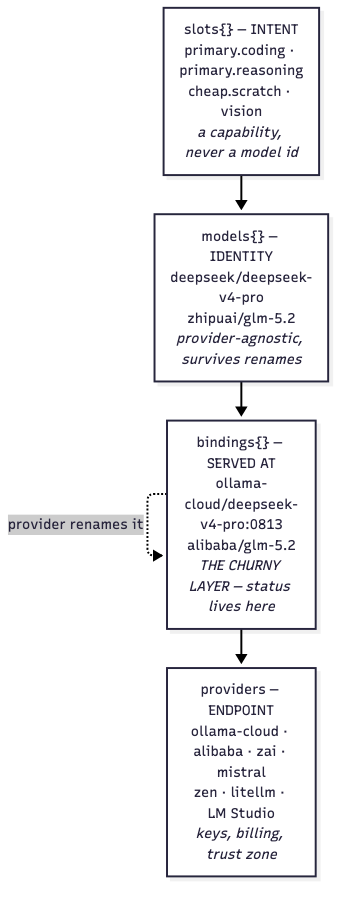
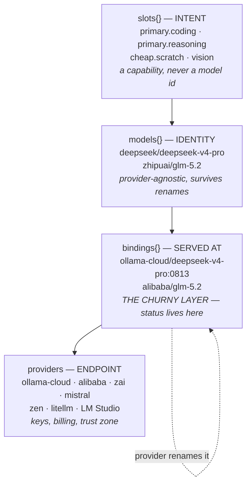
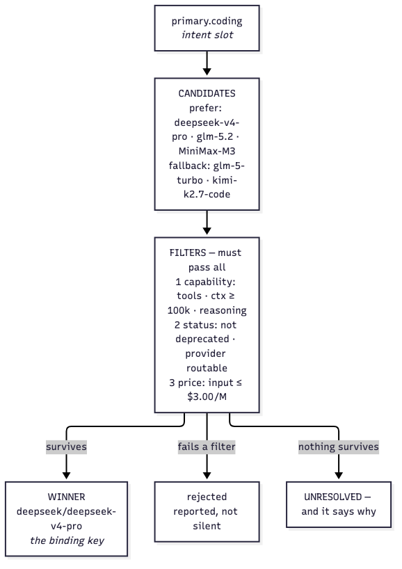
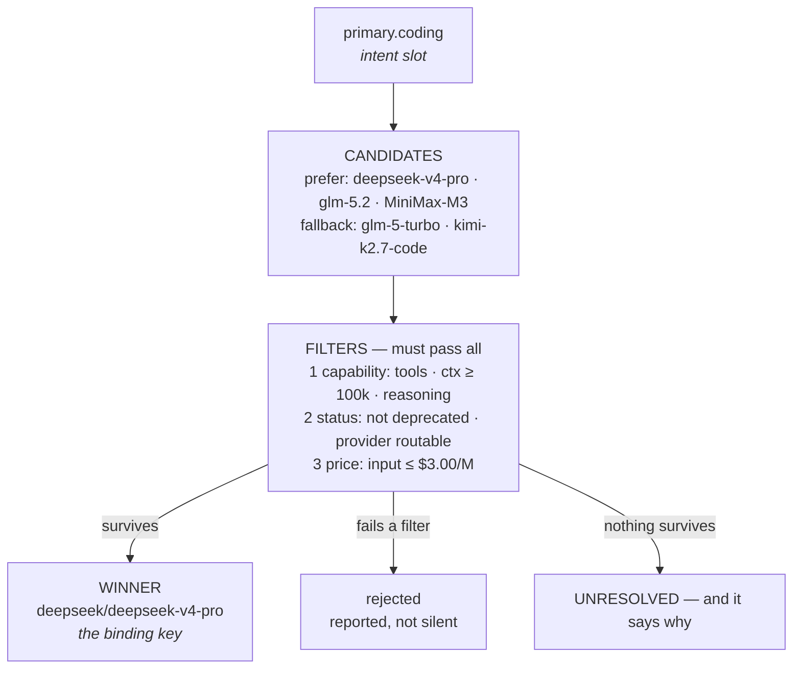
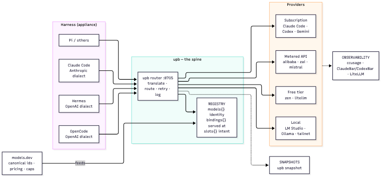
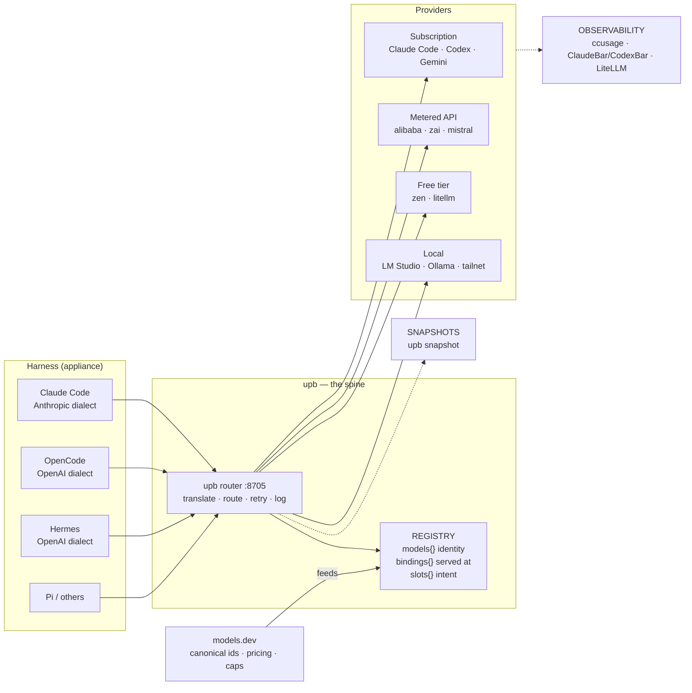
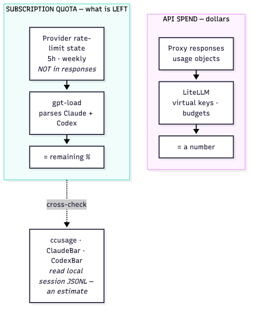
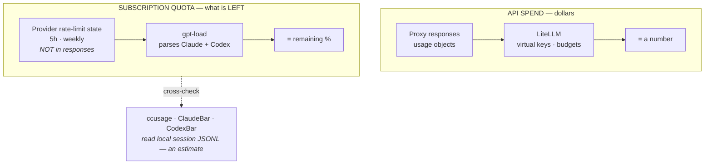

# The Model Registry — Canonical Identity for a Churning World

> Why this document exists: provider model ids churn constantly. `deepseek-v4-pro`
> became `deepseek-v4-pro:0813`. `deepseek-v4-flash` became `deepseek-v4.1-flash`.
> `glm-5.1` became `glm-5.3`. Four models in one catalogue vanished outright. If
> your config names models directly, you are maintaining a list that is wrong
> before you finish reading it.
>
> This document explains the registry design, how it is implemented in `upb`, and
> how to operate it. For the broader landscape survey see
> [`research/ROUTER-OF-ROUTERS.md`](research/ROUTER-OF-ROUTERS.md) and
> [`research/MODEL-REGISTRY-RESEARCH.md`](research/MODEL-REGISTRY-RESEARCH.md).

---

## The problem, measured

The rot is not hypothetical. Here is what your own catalogue looked like when
audited against live provider endpoints on 2026-10-23:

| You declare | What the provider actually serves |
|---|---|
| `deepseek-v4-pro` | `deepseek-v4-pro:0813` |
| `deepseek-v4-flash` | `deepseek-v4.1-flash` |
| `glm-5.1` | `glm-5.3` |
| `qwen3-coder-next` | gone |
| `devstral-2:123b` | gone |
| `gemini-3-flash-preview` | gone |
| `qwen3.5:397b` | gone |
| `deepseek-v3.2` | gone |

**13 of 47 bindings were not served.** Ollama-cloud serves 23 models; 20 were
declared, 10 of them wrong. Zen serves 85 models; 3 were declared, 2 of them
dead. Meanwhile `upb verify` already existed and could have caught most of this
— the gap was never tooling, it was that nothing ran the check or kept the
results.

## The idea: separate what churns from what does not

Three layers, so a rename becomes a one-line edit instead of a config rewrite.



The layer that churns is **layer 3 only**. Layers 1 and 2 are stable because they
are not tied to any provider's naming choices.



**Layer 1 — `slots{}` (intent).** You ask for `primary.coding`, not for
`deepseek-v4-pro`. A slot is a capability contract plus a cost ceiling. This is
the only layer a route should ever be expressed in.

**Layer 2 — `models{}` (identity).** The canonical model id, provider-agnostic.
`deepseek/deepseek-v4-pro` is the same model whether Ollama calls it
`deepseek-v4-pro`, Alibaba calls it `deepseek-v4-pro-0813`, or a third party
calls it `deepseek/deepseek-v4-pro`.

**Layer 3 — `bindings{}` (served at).** Where a canonical model is actually
available right now, under which provider's id, at what price, and with what
status. **Status lives here, not on the model** — the same model can be
`deprecated` at one provider and `active` at another. Status is a property of
the binding, never of the model.

**Layer 4 — `providers` (endpoint).** Base URL, auth reference, key slots,
billing model, trust zone.

## Where the data comes from

| Layer | Source of truth | Notes |
|---|---|---|
| Canonical ids, pricing, capabilities | [models.dev](https://models.dev) | `canonical_model_id` present on 85.1% of 9,149 provider-scoped entries; 629 distinct canonical models, 482 served by more than one provider |
| Which models a provider serves | live `GET {base_url}/models` | Ground truth. A provider that still serves a model is serving it. |
| Declared models | `~/.config/upb/routes.yaml` | Your intent |
| Status, slots, notes, key slots | `~/.config/upb/registry.yaml` (manual edits) | Survive a rebuild |
| Deprecation dates | LiteLLM / AWS `modelLifecycle` | Always paired with a source URL |

### Three precedence rules that matter

**1. The provider's own catalogue outranks models.dev for status.** A model
models.dev marks `deprecated` but the provider still serves is *not* deprecated
in practice. Stale community catalogs are the usual cause of false "deprecated"
warnings. The registry prefers `provider_api` over `models.dev` and records
which source decided.

**2. Canonical identity resolves from a global index, not a provider namespace.**
`alibaba` does not list `glm-5.3` even though `alibaba-token-plan` does.
Canonical identity is a property of the *model*, not of the provider's
namespace, so the registry builds an index across every models.dev provider
namespace and resolves from that.

**3. `enabled: false` in routes.yaml does not mean "unavailable".** It means
"not eligible as the default route" — a metered provider that must never be
the default is still a perfectly good slot target. The registry tracks
`routable` separately from `enabled`.

## How a slot resolves





**The price ceiling defaults to the input price.** Agentic coding re-reads a
long context every turn, so input tokens dominate the bill. Applying the
ceiling to output instead is a common and expensive mistake. Override it
explicitly with `cost_ceiling_applies_to: output | max`.

**An unknown price does not block routing.** A binding with no price data is
treated as within the ceiling — otherwise every unpriced local or free-tier
model would be unroutable.

**Every decision is inspectable:**

```console
$ upb registry resolve primary.coding --json
{
  "binding": "deepseek/deepseek-v4-pro",
  "canonical": "deepseek/deepseek-v4-pro-0813",
  "status": "active",
  "tier": "prefer",
  "reference": "deepseek/deepseek-v4-pro",
  "considered": ["deepseek/deepseek-v4-pro", "ollama-cloud/deepseek-v4-pro"]
}
```

Note what that output says: the slot named a *canonical* model, the resolver
considered every provider serving it, and it handed back a **binding key** —
provider plus the id that provider actually uses. `ollama-cloud` serves the
same canonical model as `deepseek-v4-pro:0813`; the winner is whichever
binding ranks best on status and provider priority.

## Where everything sits





## The observability split

Two questions, two data sources, and no single tool answers both.





**Why both are needed:** no tool can see your Claude Max or Codex allowance from
API response payloads. Remaining quota lives in Anthropic's and OpenAI's
rate-limit state, which you can only poll (`claude /usage`, the Codex quota
endpoint) or reconstruct from local session logs. ccusage tells you how much you
*burned*; ClaudeBar and CodexBar tell you how much is *left*.

## Commands

| Command | What it does |
|---|---|
| `upb registry build` | Merge `routes.yaml` + models.dev + live catalogues into `registry.yaml` |
| `upb registry show` | Grouped by status, with per-binding observations |
| `upb registry validate` | Enforce the field rules |
| `upb registry slots` | List intent slots and what each resolves to |
| `upb registry resolve SLOT` | Resolve one slot to a concrete binding |
| `upb registry drift` | Compare the registry against live provider catalogues |
| `upb snapshot [--label L]` | Record what was running right now |

### Build

```console
$ upb registry build
wrote ~/.config/upb/registry.yaml
  providers: 9
  canonical models: 44
  bindings: 47
  slots: 4
  warnings: 1
    ! provider 'zen': remote endpoint with no auth
```

### Drift — the command that finds rot

```console
$ upb registry drift
checked 9 providers at 2026-10-23T04:48:52+01:00
  alibaba: 20 live, 6 declared, 1 not served, 15 new upstream
  zen: 85 live, 3 declared, 2 not served, 84 new upstream
  ollama-cloud: 23 live, 20 declared, 10 not served, 13 new upstream

not served (declared but absent from the provider catalogue):
  ✗ ollama-cloud/deepseek-v4-pro
  ✗ ollama-cloud/glm-5.1
  ✗ ollama-cloud/qwen3-coder-next
  ...

new upstream (not declared):
  + alibaba/qwen3.8-max
  + alibaba/glm-5.3
  ...
```

Exit code `3` when something is not served or is deprecated — so it drops
straight into CI or a pre-commit hook.

### Snapshot — "what was I running at time T?"

```console
$ upb snapshot --label baseline
wrote ~/.local/share/upb/snapshots/2026-10-23T045215-baseline.json
  providers: 9
  catalogues captured: 128 ids across 3 providers
  routes sha256: db94a5b70ad9f3b1…
```

Each snapshot records the `routes.yaml` digest, every provider's live catalogue
of ids, and each binding's status and price. Comparing two snapshots surfaces
provider renames:

```console
$ upb snapshot --label after-rename
wrote ~/.local/share/upb/snapshots/2026-10-23T045217-after-rename.json
  renames detected:
    ~ ollama-cloud: deepseek-v4-pro → deepseek-v4-pro:0813 (exact)
```

A rename is detected when an id leaves the catalogue and a new id arrives
carrying the same family. A 1:1 pairing is *exact*; when several leave and
several arrive in one family it is reported as *ambiguous* rather than guessed.

## The file format

`~/.config/upb/registry.yaml` — generated, with your manual edits preserved.

```yaml
schema_version: 1
generated_at: 2026-10-23T04:48:51+01:00

providers:
  ollama-cloud:
    display_name: Ollama Cloud
    kind: upb
    billing: unknown
    trust_zone: remote-approved
    base_url: https://ollama.com/v1
    enabled: false          # not the default route
    routable: true          # still a valid slot target
    models_dev_id: ollama-cloud
    auth:                   # a REFERENCE, never a value
      type: envfile
      path: ~/.hermes/.env
      var: OLLAMA_API_KEY
    key_slots: []
    priority: 90
    status: not-default

models:
  zhipuai/glm-5.2:
    display_name: glm-5.2
    family: glm
    vendor: zhipuai
    release_date: ''
    open_weights: true
    capabilities:
      tools: true
      reasoning: true
      structured_output: false
      vision: false
      temperature: true
    context_window: 976000
    max_output_tokens: 976000

bindings:
  ollama-cloud/glm-5.2:
    provider: ollama-cloud
    model_id: glm-5.2
    canonical: zhipuai/glm-5.2
    status: active            # active | backup | deprecated | unknown
    status_source: provider_api
    status_checked_at: 2026-10-23
    upstream_status: null
    deprecation_date: null
    deprecation_source: null
    superseded_by: null
    price:
      input_per_1m: 1.4
      output_per_1m: 4.4
      cache_read_per_1m: null
      source: models.dev
    observed:
      in_provider_catalog: true
      last_seen_at: 2026-10-23
      renamed_to: null
    notes: ''

slots:
  primary.coding:
    require: { capability: [tools], context_window_min: 100000 }
    cost_ceiling_per_1m: 3.00
    cost_ceiling_applies_to: input
    prefer:
      - deepseek/deepseek-v4-pro
      - zhipuai/glm-5.2
      - minimax/MiniMax-M3
    fallback:
      - zhipuai/glm-5-turbo
      - moonshotai/kimi-k2.7-code
    notes: Cheapest model that can actually do agentic coding with a long context.
```

### What survives a rebuild

| Field | Behaviour |
|---|---|
| `status` with `status_source: manual` | preserved — your call wins |
| `slots{}` | preserved entirely |
| `notes`, `key_slots`, `superseded_by` | preserved |
| canonical ids, pricing, capabilities, `observed` | regenerated from sources |

To pin a model as a permanent fallback rather than letting the upstream catalog
decide, mark it by hand:

```yaml
bindings:
  ollama-cloud/glm-5.1:
    status: backup
    status_source: manual
    notes: keep as the always-there fallback; provider will drop it eventually
```

## Validation rules

`upb registry validate` enforces:

1. `status` ∈ {active, backup, deprecated, unknown}
2. `binding.provider` + `binding.model_id` is unique — exact match, never fuzzy
3. `binding.canonical` must exist in `models{}`
4. `slot.bind_to` must resolve to an existing binding or model
5. `deprecation_date` present ⇒ `deprecation_source` present (no unsourced dates)
6. Every binding has `status_checked_at`; stale (> 7 days) ⇒ warning
7. No secret material — anything matching `sk-*` / `AIza*` / a JWT is rejected

The validator is what caught the dangling `zhipuai/glm-5.3` reference in this
repo's own registry during development.

## Operating it

```console
# weekly: what changed upstream?
upb registry drift

# after a provider announces a change: record where we were
upb snapshot --label before-upgrade

# refresh the registry (facts update, your decisions persist)
upb registry build

# a new model appeared upstream and you want it
#   1. add it to routes.yaml under the provider
#   2. upb registry build
#   3. upb registry resolve <slot> --json

# a model died: decide its fate
#   1. upb registry show --status unknown
#   2. mark it status: backup (keep it) or remove it from routes.yaml
#   3. upb registry build   # the manual status survives
```

## Tests

```console
$ python3 cli/test_registry.py
Ran 32 tests in 0.3s
OK
```

Covering rename detection, slot resolution (including the cost-ceiling
semantics and the enabled/routable distinction), the validation rules, rebuild
merge semantics, and the CLI surface.

## Diagram sources

Every diagram exists twice, deliberately:

**As mermaid** — embedded above, so it renders in Obsidian, GitHub and any
markdown viewer with no tooling at all. This is the copy most people read.

**As Excalidraw** — hand-drawn, editable at [excalidraw.com](https://excalidraw.com),
for when you want to change the picture:

```console
$ python3 docs/diagrams/generate.py   # writes the .excalidraw files
$ python3 docs/diagrams/render.py      # renders .png/.svg for local review
```

`generate.py` is the source of truth for the Excalidraw versions; the mermaid
blocks in this document are edited by hand. If you change one, change the
other — there is no automatic sync, and that is deliberate: the two formats
carry different amounts of detail.

The rendered PNGs committed to the repo are the mermaid versions, so the
markdown renders correctly on a fresh clone with no build step.
